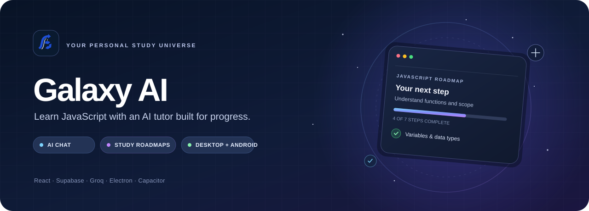

# Galaxy AI

<p align="center">
  
</p>

<p align="center">
  A focused learning companion for JavaScript study, AI chat, and guided roadmaps.<br>
  Built with React, Vite, Supabase, Groq, Electron, and Capacitor.
</p>

<p align="center">
  <a href="https://github.com/Yashu2004-25/galaxyAI/releases/latest">Latest downloads</a> ·
  <a href="#quick-start">Quick start</a> ·
  <a href="#build-for-windows-and-android">Build apps</a>
</p>

## Features

- AI chat with Groq streaming, model selection, study modes, Markdown, and code highlighting.
- Guided study roadmaps with research, verified YouTube links, progress tracking, and saved plans.
- Supabase email/password authentication and user-scoped data protected with Row Level Security.
- Secure on-device storage for provider keys in Electron and Android.
- One shared React application packaged as a Windows installer, portable Windows app, and Android APK.

## Quick start

### Prerequisites

- Node.js LTS and npm.
- Git.
- For Android builds: Android Studio, Android SDK Platform 35, Android SDK Build-Tools, and JDK 17 or newer.
- Windows is required to build the Windows installer and portable `.exe` with the included scripts.

### 1. Get the source and install packages

Run from PowerShell:

```powershell
git clone https://github.com/Yashu2004-25/galaxyAI.git
cd galaxyAI
npm ci
```

If you already have the repository, open PowerShell in its root folder and run `npm ci` after a fresh checkout or `package.json` changes.

### 2. Configure the app

Create the local environment file and set the Supabase values:

```powershell
Copy-Item .env.example .env
notepad .env
```

Set `VITE_SUPABASE_URL` and `VITE_SUPABASE_ANON_KEY` in `.env`. Use only the public anon key; never put a Supabase `service_role` key in a client app. Run [`sql/schema.sql`](sql/schema.sql) in the Supabase SQL Editor and enable email/password authentication.

The Supabase URL and anon key are embedded when Vite builds the app. Rebuild after changing `.env`. Configure a Groq key from the app's Settings screen before using chat or roadmaps; a YouTube API key is optional.

For Android, point Gradle at the installed SDK if `android/local.properties` does not already exist:

```powershell
'sdk.dir=' + ($env:LOCALAPPDATA + '/Android/Sdk') | Set-Content -Encoding ASCII android/local.properties
```

Change the SDK path if Android Studio installed it somewhere else. `android/local.properties` is machine-specific and is not committed.

### 3. Run in development

```powershell
npm run dev           # Web app at http://localhost:5173
npm run electron:dev  # Windows desktop app
```

Browser development stores provider keys in localStorage, which is not encrypted. Use the desktop or Android app for secure OS-backed key storage.

## Build for Windows and Android

Run commands from the repository root. Each platform command builds the web app automatically; the Android command also syncs the web assets and Capacitor plugins.

```powershell
npm run electron:build # Windows installer and portable .exe
npm run android:debug  # Installable Android debug APK
```

### Build outputs

| App | File path |
| --- | --- |
| Windows installer | `release\Galaxy AI Setup 1.0.0.exe` |
| Windows portable app | `release\Galaxy AI 1.0.0.exe` |
| Android debug APK | `android\app\build\outputs\apk\debug\app-debug.apk` |

The `release/` directory and Android build directory are ignored by Git. The files are created on your computer after building. Published downloads are attached to the [latest GitHub Release](https://github.com/Yashu2004-25/galaxyAI/releases/latest).

### Rebuild after editing code

Save your changes, then run the build command for each app you want to update:

```powershell
npm run electron:build # Rebuilds both Windows .exe files
npm run android:debug  # Rebuilds the Android debug APK
```

If you edit only the web app and want a quick local preview, use `npm run dev` or `npm run electron:dev`. If you change `.env`, rebuild the app too so the new Supabase configuration is included.

### Optional Android release APK

```powershell
npm run android:release
```

Configure release signing with your own keystore before distributing a release APK. Keep keystores and passwords out of Git. The debug APK is suitable for local installation and testing; use a signed release APK for distribution.

### Icons and tests

```powershell
npm run icons # Regenerate desktop and Android icons from the artwork
npm test      # Run the unit tests
```

## Project structure

```text
galaxyAI/
├── android/                 # Native Android project and Capacitor configuration
│   └── app/                 # Android application, resources, and APK build output
├── docs/                    # README artwork and project documentation assets
├── electron/                # Electron main process and secure preload bridge
├── public/                  # Web-served assets and source icon artwork
├── scripts/                 # Icon generation and Android icon sync scripts
├── sql/                     # Supabase database schema and Row Level Security policies
├── src/
│   ├── lib/                 # Supabase client and secure storage helpers
│   ├── services/            # AI, roadmap, and Supabase data services
│   ├── store/               # Chat, settings, auth, and roadmap state
│   └── styles.css           # Application styles
├── tests/                   # Unit tests
├── .env.example             # Environment variable template (copy to .env)
├── capacitor.config.json    # Capacitor app configuration
├── package.json             # Dependencies, build scripts, and packaging settings
└── vite.config.js           # Vite web build configuration
```

## Download the apps

When a release is published, download the Windows installer, portable `.exe`, or Android APK from [GitHub Releases](https://github.com/Yashu2004-25/galaxyAI/releases/latest). To create the files locally, use the build commands above.
